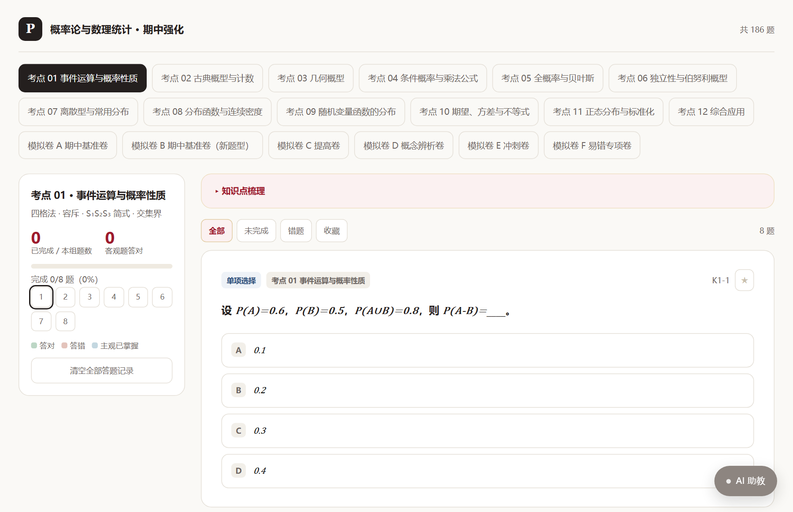

# quiz-review

把一门课的课件、真题、作业，变成一套能直接做题的网页。

生成的产物是一个 HTML 文件：选择题和判断题点一下就知道对错，填空题逐空核对，简答与计算题可以对照评分点自评，也可以让 AI 助教判卷。每个板块开头有知识点梳理，答题进度存在本机浏览器，换设备就重来（没有账号系统）。



在线示例（都是这套模板生成的）：

| 示例 | 规模 | 链接 |
| --- | --- | --- |
| 概率论与数理统计 · 期中强化 | 186 题 / 18 板块 | [打开](https://kerrychia.github.io/quiz-review/) |
| 数据结构与算法 · 期末复习 | 9 题 / 4 板块 | [打开](https://kerrychia.github.io/quiz-review/demo.html) |

手机上直接扫也行，排版是单栏的。第一个示例的题库源码在 `examples/probability/data`，可以照着它的规模改。

---

## 怎么用

把下面这句话复制给你的 AI 助手：

```text
使用 https://github.com/KerryChia/quiz-review 这个 skill，帮我做一套课程刷题网页。
```

要求你的助手能读写本地文件、能执行命令（Claude Code、Cursor、WorkBuddy、Codex 之类都行）。它需要先把这个仓库拉到本地。

然后它会带你走完这几步：

1. **找资料** — 它会在你指定的文件夹里找课件、真题、作业；一份都没有就让你先放进去
2. **问两个问题** — 要多少题、要不要 AI 助教
3. **出题** — 读完资料，按章节拆板块，一个板块一个文件地写
4. **构建** — 生成 `dist/index.html`，双击就能做

全程你不用懂代码。它问什么你答什么就行。

---

## 它会问你什么

**要多少题**

它会按你的资料量给几个选项，一般是 80 / 150 / 240 / 400 题，并告诉你大概要做多久。题太少覆盖不全，题太多做不完，选中间那档通常最合适。

**要不要 AI 助教**

要的话，每道题都能让 AI 看着题干和参考答案讲思路、指易错点、回答追问；简答和计算题还能按评分点判卷。

AI 用的是**你自己的 API Key**，只存在你浏览器里。它会再问你一句「有没有现成的 AI 供应商」：

- 有（DeepSeek、OpenAI、硅基流动等都行）→ 直接生成，你第一次打开页面时填地址和 Key
- 没有 → 它会给你 [DeepSeek 开放平台](https://platform.deepseek.com/) 的链接，注册后充几块钱就够刷完一门课

Key 不会出现在对话里，也不会写进任何文件。你第一次打开生成的 HTML 时，会弹一个框让你填 Base URL（默认 `https://api.deepseek.com`）和 API Key，只保存在当前浏览器。模型默认 `deepseek-flash`，想换在「高级：模型名」里改。

不要 AI 助教的话，这块会整个去掉，页面更干净，文件也更小。

---

## 生成的东西

- **单文件**：一个 `index.html`，没有外部依赖，可以直接发微信、传网盘、丢到任何静态托管
- **四种题型**：单选、判断、填空、简答/计算
- **即时判分**：选择题点选项就出结果，解析自动展开
- **等价写法**：填空题支持 `1/2` 与 `0.5`、全角半角、大小写、上下标
- **知识点梳理**：每个板块开头可折叠，先看再做题
- **错题与收藏**：侧栏按「未完成 / 错题 / 收藏」筛
- **进度保存**：存在 `localStorage`，关掉再开还在
- **手机和电脑都好用**：电脑双栏、侧栏吸顶；手机单栏、翻页条吸底、公式过长只在公式内部横滑，页面本身不会左右晃

---

## 不包含什么

线上版本里的**账号登录、邮箱验证、云端同步、服务端判卷**不在这个仓库里，也不打算开源。这套东西涉及邮箱服务、数据库和密钥管理，每个人部署的环境都不一样。

这里的取舍是：**零部署、零后端、零托管成本**。代价是换浏览器或清缓存会丢进度。

---

## 隐私

- 仓库里没有任何个人姓名、学校、邮箱、域名、服务器地址或密钥
- 生成的题库只在你本地处理，不会上传
- AI 请求从你的浏览器直接发给你填的服务商，不经过任何中转
- 不要把自己的 API Key 写进 `course.json` 或任何要提交的文件

题库内容请只用于个人复习。受版权保护的真题原文建议改写后使用，不要整卷传播。

---

## 仓库结构

```
quiz-review/
├── SKILL.md                  # 给 AI 助手的执行手册
├── assets/
│   ├── template.html         # 页面模板（含公式渲染、判分、进度、双端样式）
│   ├── tutor.css             # AI 助教样式
│   └── tutor.js              # AI 助教逻辑（纯前端）
├── scripts/
│   ├── build.py              # 题库 → 单文件 HTML
│   └── validate.py           # 题库校验
├── references/
│   ├── data-schema.md        # 题库字段说明
│   ├── authoring.md          # 出题与解析规范
│   └── ai-tutor.md           # AI 助教接入说明
├── examples/
│   ├── demo/                 # 9 题最小示例（数据结构）
│   └── probability/          # 186 题完整示例（概率论）
└── docs/                     # 上面两个示例构建出的在线版本
```

## 自己构建

```bash
git clone https://github.com/KerryChia/quiz-review.git
cd quiz-review/examples/demo

python ../../scripts/validate.py --data data
python ../../scripts/build.py --data data --out dist/index.html --open
```

`examples/demo/data` 是 9 题的最小示例，照着改就行。想看大题量的组织方式就翻 `examples/probability/data`：18 个板块、186 题、每板块一个文件。

构建参数：

| 参数 | 说明 |
| --- | --- |
| `--data` | 数据目录，默认 `./data` |
| `--out` | 输出路径，默认 `./dist/index.html` |
| `--ai` / `--no-ai` | 强制开关 AI 助教，覆盖 `course.json` |
| `--force` | 有校验错误也构建（交付前别用） |
| `--open` | 构建完自动打开 |

字段怎么写看 [references/data-schema.md](references/data-schema.md)，题目怎么出看 [references/authoring.md](references/authoring.md)。

---

## License

MIT。题库内容归各自的版权方，仓库只提供工具与模板。
